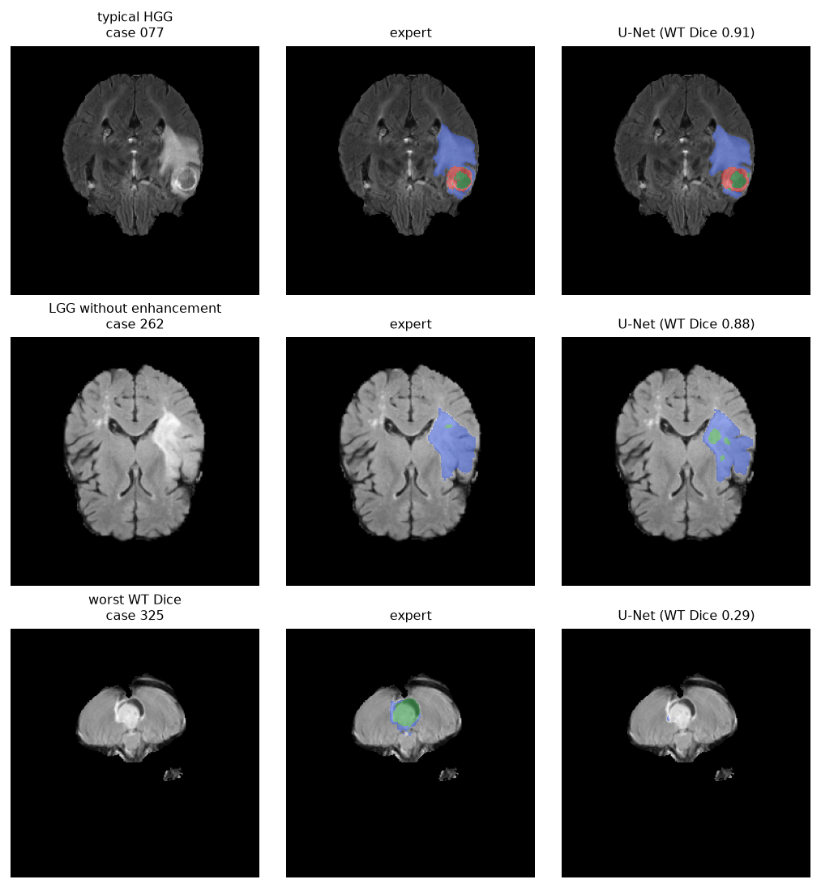
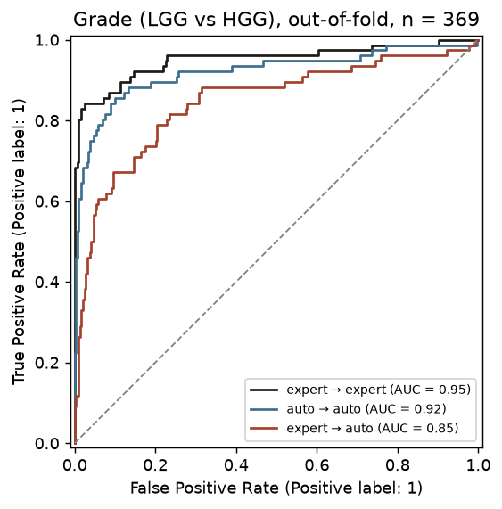

# Glioma pipeline: segmentation → radiomics → grade and survival

Do automatic tumor masks work as well as expert masks for radiomics?

A U-Net draws the tumor mask, radiomics features are computed from that mask, and the features go into a
grade model (LGG vs HGG) and a survival model. Everything is compared with the same pipeline run on the expert
masks. Data: BraTS 2020, 369 patients (293 HGG, 76 LGG), survival for 236 HGG patients.

This connects two earlier projects:
[brain tumor segmentation](https://github.com/aliebrahiminiya01/brain-tumor-segmentation-unet) and
[glioma grade radiomics](https://github.com/aliebrahiminiya01/glioma-grade-radiomics).

## Results

| | expert masks | U-Net masks |
|---|---|---|
| Whole-tumor Dice vs expert (median) | — | 0.91 |
| Grade AUC, model trained on the same mask type | 0.95 (0.92–0.98) | 0.92 (0.87–0.96) |
| Grade AUC, model trained on expert masks | 0.95 | **0.85** (0.79–0.90) |
| Survival C-index, age + resection + tumor shape | 0.63 (0.59–0.67) | 0.61 (0.57–0.65) |
| Survival C-index, age + resection only | 0.62 | 0.62 |

95% bootstrap intervals in brackets.

- **The U-Net segments the whole tumor well** (median Dice 0.92 for HGG, 0.90 for LGG). But it marks a small
  enhancing region in **26 of the 27 LGG that don't enhance at all**. The models were trained on ~80% HGG.
- **For grade, U-Net masks are almost as good**, as long as the grade model is also trained on U-Net masks.
  A model trained on expert masks and applied to U-Net masks drops to AUC 0.85. It relies on "no enhancement →
  LGG", which is exactly what the U-Net gets wrong.
- **For survival the mask type barely matters**, because tumor shape adds little to age: 0.62 → 0.63, well
  within noise for 236 patients.
- **Maximum-diameter features do not transfer** (Spearman ρ ≈ 0 between expert and U-Net masks). The U-Net masks
  have a median of 22 separate pieces (expert masks: 8), and one tiny stray piece is enough to inflate the
  diameter.





## Method

1. **Folds.** The 369 patients are split into 3 folds, stratified by grade and by whether survival is known.
   The same folds are used everywhere, so a patient in a test fold was never seen by the U-Net or by the
   grade/survival model.
2. **Segmentation** (`src/prepare_slices.py`, `src/train.py`, `src/predict.py`). The 2D U-Net from the
   segmentation project (MONAI, 6.5 M parameters) is trained 3 times for 10 epochs, each time on two folds.
   Each patient's mask is then predicted by the model that held them out (about 90 minutes of training on a
   MacBook Air).
3. **Radiomics** (`src/extract_features.py`). The same PyRadiomics features as in the radiomics project, from
   expert and from U-Net masks.
4. **Grade.** LASSO logistic regression on the 48 shape features (the selected model of the radiomics project).
5. **Survival.** Cox model with a small ridge penalty: age and extent of resection, plus volume or shape
   features. Evaluated with the C-index.

## Limitations

- 2D U-Net, 10 epochs per fold; a 3D model would likely segment better.
- Only shape features: texture features carry a strong scanner fingerprint in BraTS (see the radiomics project).
- Survival is only available for HGG, and for 236 patients; the differences between survival models are not
  significant.
- BraTS 2020 grade is strongly confounded with the data source (see the radiomics project).

## Next steps

- Keep only the largest connected region of each U-Net mask.
- Train the U-Net with more weight on LGG to reduce false enhancement.

## How to run

```bash
python3.11 -m venv .venv
.venv/bin/pip install "numpy<2" setuptools wheel versioneer
.venv/bin/pip install --no-build-isolation pyradiomics==3.0.1
.venv/bin/pip install -r requirements.txt

# BraTS 2020 as prepared by the radiomics project (../Glioma_Grade_Radiomics/data/brats2020)
.venv/bin/python src/prepare_slices.py                 # folds + 2D slices (~4 GB)
for k in 0 1 2; do .venv/bin/python src/train.py --fold $k; done
.venv/bin/python src/predict.py                        # 3D masks for all patients
.venv/bin/python src/extract_features.py --masks data/auto_masks --out data/features_auto.csv
# expert-mask features: ../Glioma_Grade_Radiomics/data/features.csv

# then run notebooks/01_segmentation.ipynb and notebooks/02_grade_and_survival.ipynb
```

Data, trained models and feature tables are not included in the repository.

## Structure

```text
src/prepare_slices.py     3 folds + 2D training slices (labels renumbered for the U-Net)
src/dataset.py            PyTorch dataset of slices
src/train.py              U-Net training for one fold
src/predict.py            3D mask prediction with the held-out fold model
src/extract_features.py   PyRadiomics features from any mask folder
src/modeling.py           feature groups and models (from the radiomics project)
notebooks/01_segmentation.ipynb         quality of the U-Net masks
notebooks/02_grade_and_survival.ipynb   expert vs U-Net masks for grade and survival
results/                  tables and figures
```
